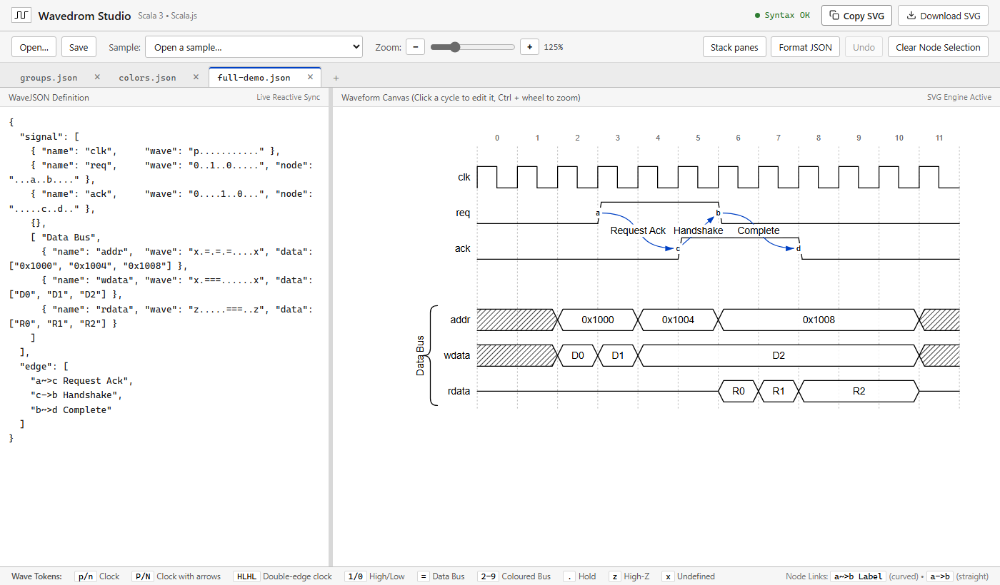
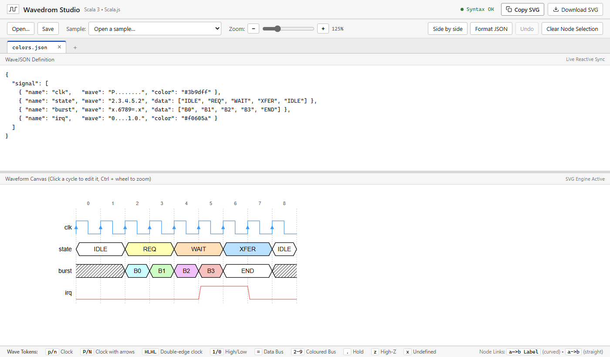
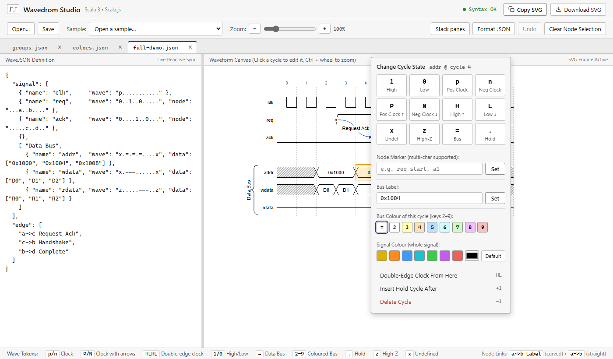

# Wavedrom Studio

An interactive editor for timing diagrams that runs entirely in the browser. You write the diagram as JSON or edit it with the mouse, and see the waveform change as you go.

Wavedrom Studio is based on [WaveDrom](https://wavedrom.com/) ([GitHub](https://github.com/wavedrom/wavedrom)), the open-source timing diagram renderer by Aliaksei Chapyzhenka. It reads and writes the same WaveJSON format and keeps WaveDrom's classic look. Diagrams made with it can be used with WaveDrom itself and the other tools that support WaveJSON. Wavedrom Studio is an independent project and is not affiliated with WaveDrom.



---

# For users

## Getting it

1. Download `wavedrom-studio-<version>.zip` from the [Releases](https://github.com/Loneknight73/wavedrom-studio/releases) page.
2. Unzip it anywhere.
3. Open `index.html` in a web browser.

That is all. There is nothing to install, and the studio works offline. Edge or Chrome is recommended, because in those browsers Save writes straight back to the file you opened.

## Features

- **Live JSON editing**: the waveform is redrawn as you type, and the status light shows whether the JSON is valid.
- **Graphical editing**: click any cycle of a wave to open the cycle editor. Every graphical edit is written back into the JSON, leaving the rest of the document as it was, and can be undone.
- **Multiple tabs**: each tab is one diagram with its own JSON, zoom and undo history. A dot marks a tab with unsaved changes.
- **Open and save files**: open one or more `.json` files at once, each in its own tab, and save them back.
- **Built-in samples**: a handshake with arrows, SPI, I²C, DDR, groups and colours, to start from or learn from.
- **Resizable panes**: drag the divider between the JSON editor and the waveform. The panes can sit side by side or one above the other.
- **Zoom**: from the toolbar or with Ctrl and the mouse wheel.
- **Classic WaveDrom look**: thin black lines, hatched undefined regions and blue arrows, on white.
- **Colours**: buses in WaveDrom's eight colours, and a colour of your choice for any whole signal.
- **Clocks with arrows**: arrows on the working edge of a clock, and clocks active on both edges.
- **Nodes and arrows**: name points on the waves and connect them with labelled arrows.
- **SVG export**: copy the diagram to the clipboard or download it as a self-contained SVG file.



## Editing a diagram

### In the JSON editor

Diagrams are written in WaveJSON, WaveDrom's format. Each signal has a name and a wave, one character per clock cycle:

```json
{
  "signal": [
    { "name": "clk",  "wave": "p......." },
    { "name": "req",  "wave": "0.1..0.." },
    { "name": "data", "wave": "x.=.=.x.", "data": ["A", "B"] }
  ]
}
```

The bar at the bottom of the window lists the most common wave characters. [WaveJSON in Wavedrom Studio](docs/wavejson.md) describes everything the studio understands, including groups, colours, nodes and arrows.

**Format JSON** lays the document out in the usual WaveJSON style.

### With the mouse

Click a cycle of any wave to open the cycle editor.



From there you can:

- **Change the state** of the cycle: high, low, clock, undefined, high impedance, bus or hold. While the editor is open, you can also press the state's key: `1 0 p n x z = .`, or Shift+P, Shift+N, Shift+H and Shift+L for the forms with arrows.
- **Set a node marker** on the cycle, to connect it to others with arrows.
- **Set the label** of a bus value.
- **Colour a bus**: pick a swatch, or press `2` to `9`.
- **Colour the whole signal**: pick a preset or any colour, or Default to go back to black.
- **Make a double-edge clock**: fill the signal from this cycle on with a clock active on both edges. Each grid cycle is then half a clock period.
- **Insert** a hold cycle after this one, or **delete** this cycle.

Clicking past the end of a short signal extends it.

### Keyboard shortcuts

| Keys | Action |
|---|---|
| Ctrl+O | Open files |
| Ctrl+S | Save the current tab |
| Ctrl+Z | Undo a graphical edit (outside the JSON editor) |
| Ctrl + mouse wheel | Zoom the waveform |
| Double-click the divider | Reset the pane sizes |

## Saving and exporting

- **Save** writes the current tab's JSON. In Edge and Chrome it saves back to the file you opened, or asks where to save a new one. In other browsers it downloads the file.
- **Copy SVG** puts the diagram on the clipboard, and **Download SVG** saves it as a file. The SVG is self-contained, so it can go straight into documents and web pages.

---

# For developers

This part is for building Wavedrom Studio from source. The studio is written in [Scala 3](https://www.scala-lang.org/) and compiled to JavaScript with [Scala.js](https://www.scala-js.org/).

## Prerequisites

- **JDK** 17 or later
- **sbt** 1.10 or later
- **Node.js** 18 or later, to run the tests and, optionally, the local web server

## Getting the source

```bash
git clone https://github.com/Loneknight73/wavedrom-studio.git
cd wavedrom-studio
```

## Building and running

| Command | What it does |
|---|---|
| `sbt fastLinkJS` | Compiles the development build to `target/scala-3.3.4/wavedrom-studio-fastopt/main.js`, which `index.html` loads. |
| `sbt ~fastLinkJS` | The same, rebuilding on every change to the source. Reload the page to see it. |
| `sbt launch` | Builds, then opens `index.html` in the default browser. |
| `npm start` | Serves the folder at <http://localhost:3000> and opens the browser. Build first. |
| `./launch.ps1` | On Windows, builds and launches in one step. |
| `sbt test` | Runs the test suites under Node.js. |

After a build you can also open `index.html` directly from disk.

## Packaging a release

```bash
sbt dist
```

This builds the optimised script and writes the files of a release to `target/dist/wavedrom-studio-<version>/`, with a zip of that folder next to it. The release holds only `index.html`, `main.js` and `LICENSE`, and needs nothing else to run. The version comes from `build.sbt`.

## Project layout

```
wavedrom-studio/
├── src/
│   ├── main/scala/wavedrom/studio/
│   │   ├── Model.scala              # Domain model: wave states, signals, diagrams
│   │   ├── WaveJsonCodec.scala      # WaveJSON parser, write-back and formatter
│   │   ├── SvgRenderer.scala        # SVG rendering of a diagram
│   │   ├── Colors.scala             # Bus palette and signal colour validation
│   │   ├── WaveEditor.scala         # Edit operations on one signal
│   │   ├── AppState.scala           # One open document: text, edits, undo
│   │   ├── Workspace.scala          # The open documents (tabs)
│   │   ├── Samples.scala            # Built-in sample diagrams
│   │   ├── FileIO.scala             # Opening and saving local files
│   │   ├── TabBar.scala             # Tab strip
│   │   ├── CyclePopover.scala       # Cycle editor
│   │   ├── SplitPane.scala          # Resizable divider between the panes
│   │   └── WaveDromStudioApp.scala  # Entry point and UI wiring
│   └── test/scala/wavedrom/studio/  # munit test suites
├── docs/                  # WaveJSON reference and README images
├── build.sbt              # Build definition, with the launch and dist tasks
├── project/               # sbt version and the Scala.js plugin
├── index.html             # The page: layout, styles and controls
├── server.js              # Zero-dependency local web server
├── package.json           # npm shortcuts
└── launch.ps1             # Windows build-and-launch script
```

## License

Wavedrom Studio is released under the [MIT License](LICENSE).
